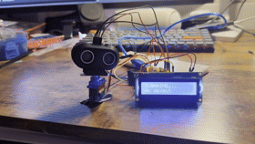
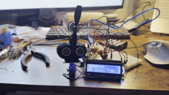
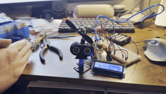
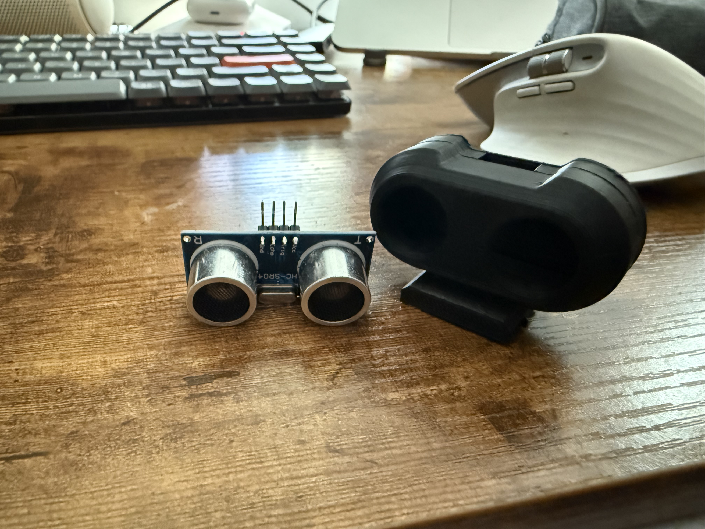
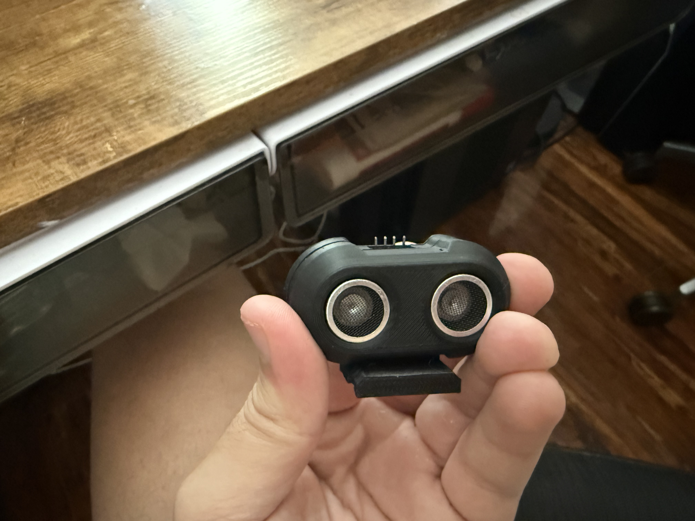
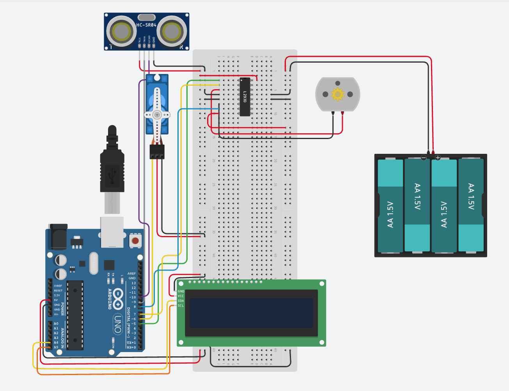

# Distance-controlled fan

An Arduino Uno scans for nearby objects with a servo-mounted HC-SR04 ultrasonic sensor. When it detects an object between 2 and 20 cm away, it pauses the sweep and drives a DC fan through an L293D H-bridge. The LCD shows distance, servo angle, and fan output.

## Video demos

The previews show the first eight seconds of each recording. Download the original MP4 to watch the full clip with audio.

| Demo 1 | Demo 2 | Demo 3 |
| --- | --- | --- |
|  |  |  |
| [View file](IMG_0273.mp4) · [Download MP4](https://github.com/KhanhDo1609/Detect_distance_fan_controlling/raw/refs/heads/main/IMG_0273.mp4?download=1) | [View file](IMG_0277.mp4) · [Download MP4](https://github.com/KhanhDo1609/Detect_distance_fan_controlling/raw/refs/heads/main/IMG_0277.mp4?download=1) | [View file](IMG_0279.mp4) · [Download MP4](https://github.com/KhanhDo1609/Detect_distance_fan_controlling/raw/refs/heads/main/IMG_0279.mp4?download=1) |

## Build photos and wiring

| HC-SR04 and 3D-printed mount | Sensor fitted into the mount |
| --- | --- |
|  |  |
| [View full size](IMG_0264.jpg) · [Download original HEIC](https://github.com/KhanhDo1609/Detect_distance_fan_controlling/raw/refs/heads/main/IMG_0264.HEIC?download=1) | [View full size](IMG_0266.jpg) · [Download original HEIC](https://github.com/KhanhDo1609/Detect_distance_fan_controlling/raw/refs/heads/main/IMG_0266.HEIC?download=1) |

[View full-size wiring diagram](wiring-diagram.png) · [Download PNG](https://github.com/KhanhDo1609/Detect_distance_fan_controlling/raw/refs/heads/main/wiring-diagram.png?download=1)

## How I built it

1. I started with the servo and the ultrasonic distance sensor. I tested the servo sweep and checked the sensor readings as it scanned.
2. I added a 3D-printed attachment to mount the sensor on the servo, then verified that the two worked together.
3. Once the scanning assembly worked, I added the DC fan motor and the L293D H-bridge. I used an external battery pack to power the motor.

## Arduino sketch

[View the sketch](detect_distance_fan_controlling.ino) · [Download the sketch](https://github.com/KhanhDo1609/Detect_distance_fan_controlling/raw/refs/heads/main/detect_distance_fan_controlling.ino?download=1)

Save the sketch inside a folder named `detect_distance_fan_controlling` and open it in the Arduino IDE. Select **Arduino Uno** and install the `Servo` library and a `LiquidCrystal_I2C` library that supports `lcd.init()`. The sketch uses a 16×2 I²C LCD at address `0x27`. Open Serial Monitor at 9600 baud to see the scan readings.

Use the pin assignments from the sketch when wiring the Uno.

| Signal | Uno pin |
| --- | --- |
| Servo signal | D6 |
| HC-SR04 TRIG | D9 |
| HC-SR04 ECHO | D10 |
| L293D enable (PWM) | D5 |
| L293D IN1 | D7 |
| L293D IN2 | D8 |
| LCD SDA | A4 |
| LCD SCL | A5 |

The sketch maps 2–20 cm to a 40–100% PWM command. The fan switches off when the target leaves range. If the sensor stays out of range for 1.5 seconds after the last detection, the servo resumes scanning.
